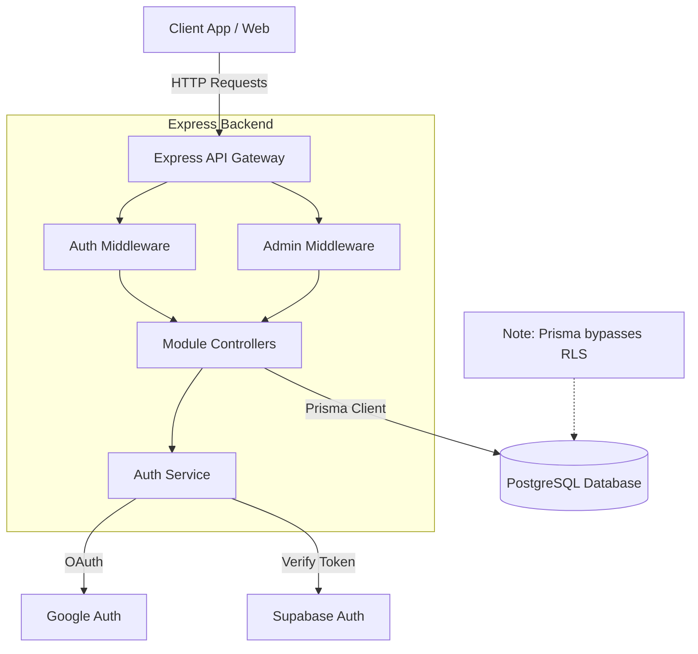

# Backend Authority Architecture

## 1. Who owns authentication?
**Custom JWT implementation**. The system uses `AuthService` to issue its own access and refresh tokens. While it integrates with Supabase Auth and Google OAuth for verification and identity continuity, the ultimate source of truth for the active session in Express is the custom JWT pair signed by `JWT_ACCESS_SECRET` (for users) and `ADMIN_JWT_SECRET` (for admins).

## 2. Who owns authorization?
**Express Middleware (`auth.middleware.ts` & `adminAuth.middleware.ts`)**. 
All authorization checks are done at the Express routing layer before hitting the controllers. Prisma does not enforce role-based access control at the database layer.

## 3. Who owns database access?
**Prisma ORM**. The backend relies exclusively on Prisma Client (`config/database.ts`) connecting via the Supabase IPv4 Pooler. Direct Supabase JS client usage is limited to file storage and legacy auth identity handoffs, not for general CRUD data operations.

## 4. Is Prisma bypassing Supabase RLS?
**YES**. Prisma connects to the database via standard connection strings (via the Supabase Pooler). It operates essentially as a superuser/service role, entirely bypassing Supabase Row Level Security (RLS) policies.
*Implications*: All data security MUST be handled in the Express layer. If the API layer has a bug, the database will not block unauthorized access.

## 5. Is there duplicated business logic?
**Yes, likely**. If there are TanStack server functions (`src/lib/admin.functions.ts`) hitting the database directly in a frontend framework alongside the Express API, the business logic (like updating an order) might be duplicated between the Express controller and the frontend server functions.

## 6. What is the single source of truth for each operation?
- **Identity/Session**: Express `AuthService` JWT.
- **Product & Inventory Data**: Prisma Database (PostgreSQL).
- **Payment Verification**: Razorpay Webhook signatures (verified in Express).
- **Images/Assets**: Local File System (`/uploads/`) or Supabase Storage (depending on environment).

## 7. Architecture Diagram

